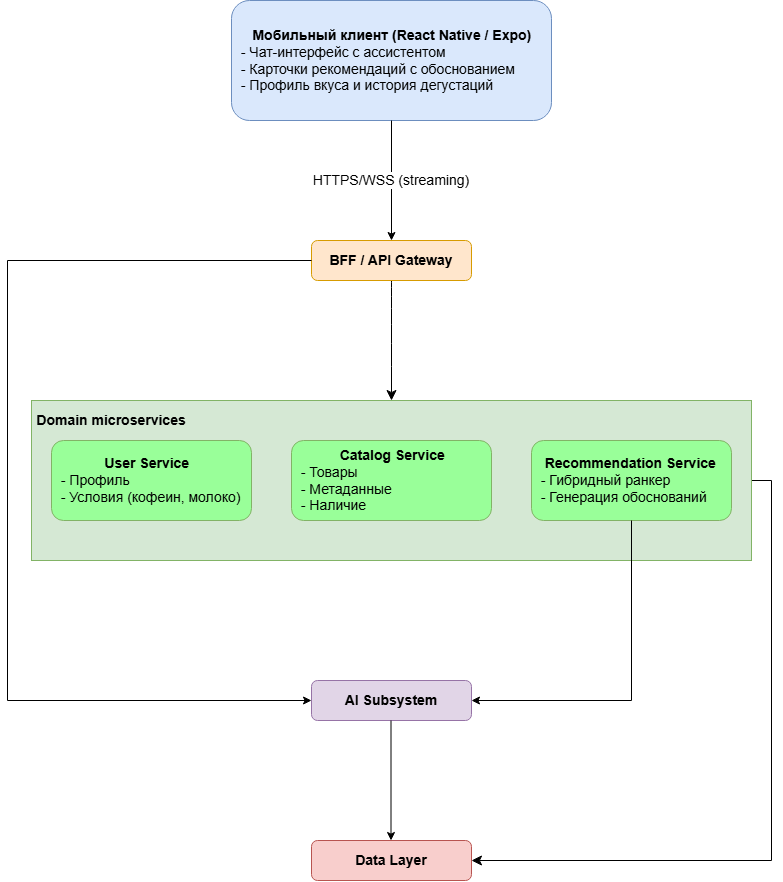

# 1. Высокоуровневая архитектура: принципы и компоненты

Система построена по гибридной схеме:

Мобильный клиент –\> BFF/API Gateway –\> доменные микросервисы –\> AI-подсистема

Главный принцип: факты считает и проверяет код, а LLM (Large Language Model) только объясняет их человеческим языком.

Такой подход снижает риск «галлюцинаций». Например, если у товара «кислотность 2 из 5», а пользователь предпочитает «4.5 из 5», код сам определяет несовпадение, а LLM не должна «додумывать», что эти числа подходят друг другу.

Рис. 1 - Высокоуровневая архитектура

# 2. Мобильный клиент

Стек технологий: React Native с Expo (единая кодовая база для iOS и Android, поддержка потоковых ответов LLM через WSS (WebSocket over TLS).

|  |  |
|----|----|
| **Блок** | **Назначение** |
| **Чат-ассистент** | Диалоговый интерфейс с потоковой выдачей ответа, историей и возможностью уточняющих вопросов |
| **Профиль вкуса** | Шкалы кислотности, тела, сладости, горечи, предпочитаемые ноты; жесткие условия (без кофеина, без лактозы), проверяются на уровне детерминированного фильтра (3.1) |
| **Карточка рекомендации** | Товар + объяснение, построенное на фактах, сформированных Recommendation Service (3.3) (сгенерированное на основе фактов, а не «придуманное» LLM) |
| **Журнал дегустаций** | Оценки, заметки, фото – основа для построения динамического профиля |

# 

# 3. Бэкенд: доменные сервисы

### **3.1. User Service**

Хранит жесткие ограничения (непереносимость лактозы, лимит кофеина) отдельно от мягких предпочтений (любит кислотность, не любит горечь). Жесткие условия передаются в Recommendation Service и применяются там как детерминированный фильтр до любого ранжирования – рекомендация, нарушающая их, не должна попасть в выдачу в принципе. User Service владеет статическим профилем (шкалы, жесткие условия, предпочитаемые ноты). Динамический профиль на основе истории дегустаций вычисляется Embedding Service (4.1) и хранится как вектор; User Service его не дублирует.

### **3.2. Catalog Service**

Хранит каталог кофе и чая и напитков на их основе с обогащенной мета-структурой: происхождение, обработка, степень обжарки, вкусовые дескрипторы, содержание кофеина (на стандартную порцию), состав. «Напиток с молоком» – это атрибут кофе или чая (milk_type), а не отдельный тип продукта. Поля, участвующие в жесткой фильтрации (3.1) и скоринге (3.3) – аллергены, кофеин, тип молока, вкусовые шкалы, дескрипторы – хранятся структурировано и индексируются; для обязательных полей действует JSON Schema-валидация, а свободное текстовое описание используется только для отображения и передачи в LLM. Общие поля (вкусовые шкалы, дескрипторы, кофеин) унифицированы для кофе и чая, тип-специфичные (обжарка, обработка, год сбора, способ заварки) расширяют базовую схему. Для гибкости схемы на этапе интеграции с поставщиками оправдано использование MongoDB как основного хранилища каталога. Изменение товара публикует событие ProductUpdated, инициирующее пересчет эмбеддинга в Embedding Service (4.1) и обновление вектора в pgvector; до завершения пересчета поиск использует предыдущую версию вектора.

### **3.3. Recommendation Service**

Центральный доменный сервис, реализующий гибридный ранкер:

1.  Жесткая фильтрация по условиям пользователя: детерминированный фильтр по структурированным полям каталога (3.2) до любого ранжирования.

2.  Кандидатная выборка – семантический поиск в векторной БД (top-N ближайших товаров к вектору запроса/профиля).

3.  Ранжирование – комбинация content-based скоринга (совпадение дескрипторов) и collaborative filtering (паттерны похожих пользователей), если накоплено достаточно данных.

4.  Формирование фактов – код вычисляет конкретные совпадения и расхождения («кислотность 4.2 при предпочтении 3.5», «содержит овсяное молоко – соответствует вашему ограничению»). Каждый факт имеет структуру {field, product_value, user_reference, verdict}, где verdict принимает match / mismatch / within_tolerance / violates_constraint.

5.  Передача фактов в AI Subsystem для генерации естественно-языкового обоснования.

Такое разделение гарантирует, что числовые и логические выводы остаются детерминированными, а LLM отвечает только за связность и тональность текста.

# 4. AI-подсистема

### **4.1. Embedding Service**

Отдельный микросервис (в MVP – модуль внутри монолита, выделяется на этапе роста), векторизующий:

1.  текстовые запросы пользователей («хочу что-то кисленькое, но не крепкое»);

2.  описания товаров и их вкусовые профили;

3.  историю дегустаций для построения динамического профиля.

Динамический профиль вычисляется как взвешенное среднее эмбеддингов записей журнала с экспоненциальным затуханием по времени (свежие дегустации весят больше) и хранится в pgvector.

### **4.2. RAG Orchestrator (LangGraph)**

Управляет состоянием диалога и последовательностью шагов:

1.  извлечение намерения и уточняющих вопросов;

2.  вызов Recommendation Service для получения кандидатов и фактов;

3.  формирование промпта для LLM, ограниченного переданными фактами;

4.  пост-проверка ответа: направление сравнения, отсутствие запрещенных утверждений, соответствие формату.

Намерение извлекается с валидацией по схеме: при неоднозначности оркестратор задает уточняющий вопрос вместо вызова рекомендаций. Факты передаются в промпт в фиксированном формате {field, product_value, user_reference, verdict}.

LLM не получает доступа к полям вне фактов и к PII – только обезличенные факты и карточка товара, пост-проверка контролирует направление сравнения, отсутствие запрещенных утверждений (при violates_constraint LLM не может утверждать, что товар подходит) и формат. При провале ответ генерируется еще раз, при повторном провале заменяется шаблонным текстом из фактов.

### **4.3. LLM Runtime и выбор модели**

Абстрактный адаптер с поддержкой нескольких провайдеров, обеспечивающий:

1.  независимость от вендора;

2.  возможность on-device inference для privacy-чувствительных сценариев;

3.  контроль затрат (маленькая модель для черновых уточнений, большая – для финального ответа).

В MVP используется один провайдер; абстракция закладывается сразу, но multi-provider и multi-model – этап роста.

# 5. Данные и хранилища

|  |  |  |
|----|----|----|
| **Компонент** | **Технология** | **Обоснование** |
| **Транзакционные данные** | PostgreSQL | Профили, жесткие условия, история дегустаций |
| **Векторный поиск** | pgvector | Векторы товаров и динамических профилей; единая БД с транзакционными данными для MVP |
| **Кэш и сессии** | Redis | Кэш рекомендаций, сессии диалога, счетчики rate limiting |
| **Каталог** | MongoDB | Гибкая схема для разнородных товаров и источников поставщиков |
| **Логи диалогов** | MongoDB | Аудит, анализ качества (включая факты и вердикты пост-проверки) |

Для MVP все компоненты разворачиваются в рамках модульного монолита. Брокер сообщений и Feature Store появляются на этапе роста для асинхронной обработки событий и онлайн-признаков ранкера.

# 6. MLOps (Machine Learning Operations) и мониторинг качества

Рекомендательная система и LLM требуют разных контуров мониторинга: для первой важны признаки и метрики ранжирования, для второй – контроль галлюцинаций и качество текста.

### **6.1. Feature Store и Model Serving**

Для ранкера рекомендуется Feature Store с онлайн и офлайн-хранилищем. Онлайн-признаки (последние оценки пользователя, популярность товара за час) подаются в Recommendation Service с задержкой \<100 мс. В MVP полноценный Feature Store не разворачивается: онлайн-признаки читаются напрямую из Redis и PostgreSQL, а офлайн-расчеты выполняются пакетными задачами. Выделенный Feature Store – этап роста.

### **6.2. Мониторинг LLM-ответов**

Помимо стандартных метрик latency/error rate, необходим контроль галлюцинаций. Контроль делится на два уровня: быстрый (синхронный) и глубокий (асинхронный). Быстрый уровень выполняется в RAG Orchestrator (4.2) и проверяет соответствие формату, наличие вердикта violates_constraint и направление сравнения. Глубокий уровень (factual consistency check) представляет собой отдельный асинхронный сервис, который проверяет, что каждое утверждение в ответе LLM имеет опору в переданных фактах. Для этого используются логи диалогов в MongoDB (5), где сохранены факты и вердикты пост-проверки. Результаты глубокой проверки и алерты при росте доли ответов, отклоненных guardrails, поступают в систему мониторинга. Выборочная человеческая оценка (human-in-the-loop) проводится на основе тех же логов для новых типов запросов.

### **6.3. A/B-тестирование**

Ранкер и промпты LLM должны проходить A/B-тесты на бизнес-метриках: конверсия в «попробовал», повторное использование, удовлетворенность рекомендацией. Технические метрики (error rate, latency) – выступают как guardrail-ограничения: вариант, нарушивший пороги по задержке или ошибкам, не может быть выбран победителем, даже если показывает рост конверсии.

# 7. Безопасность и конфиденциальность

Приложение обрабатывает вкусовые предпочтения и ограничения, что относится к персональным данным.

1.  Минимизация данных: в LLM передаются только обезличенные дескрипторы («пользователь предпочитает кислотность 4 из 5»), а не идентификаторы или история целиком.

2.  Изоляция PII **(Personally Identifiable Information)**: профиль пользователя хранится в PostgreSQL; RAG Orchestrator передает в LLM только обезличенные факты и карточку товара, а прямой доступ к таблицам с PII у LLM отсутствует архитектурно; внутренние вызовы между сервисами выполняются в доверенной сети.

3.  On-device RAG (опционально): для премиум-сегмента возможна локальная векторизация запросов и кэширование эмбеддингов на устройстве, чтобы чувствительные запросы не покидали телефон.

4.  Соответствие GDPR: прозрачность в отношении использования ИИ, право на удаление истории, документирование логики рекомендаций (объяснимость). Удаление профиля каскадируется на связанные данные – логи диалогов, историю дегустаций и векторы динамического профиля, оркестрация удаления выполняется на уровне BFF/Admin.

# 8. Варианты развертывания

|  |  |
|----|----|
| **Сценарий** | **Архитектура** |
| **MVP / стартап** | Модульный монолит на FastAPI + PostgreSQL/pgvector + MongoDB (каталог, логи) + один LLM-провайдер; мобильный клиент на Expo |
| **Рост** | Выделение Recommendation Service и Embedding Service в отдельные контейнеры; Redis для кэша; Qdrant для векторов |
| **Enterprise / privacy-first** | Гибрид: облачный LLM для общих запросов + локальная модель (Ollama / vLLM) для чувствительных; on-device эмбеддинги для офлайн-режима |

# 

# Резюме ключевых архитектурных решений

1.  LLM – объясняет факты, сгенерированные детерминированным кодом. Это снижает риск галлюцинаций в критичных для пользователя аспектах, хотя и не устраняет его полностью.

2.  Жесткие фильтры отделены от мягких предпочтений – нарушение условий пользователя исключается на уровне архитектуры детерминированным фильтром до любого ранжирования.

3.  Гибридный поиск (векторный + фильтры + ранкер) дает релевантность, которую чистый RAG или чистый collaborative filtering не обеспечивают по отдельности.

4.  Стек ориентирован на мобильность: React Native/Expo, потоковые ответы, возможность on-device inference для privacy-сценариев.

5.  MLOps с контролем качества LLM – обязательный компонент, а не опция, поскольку предметная область чувствительна к ошибкам в описании вкуса и состава.
